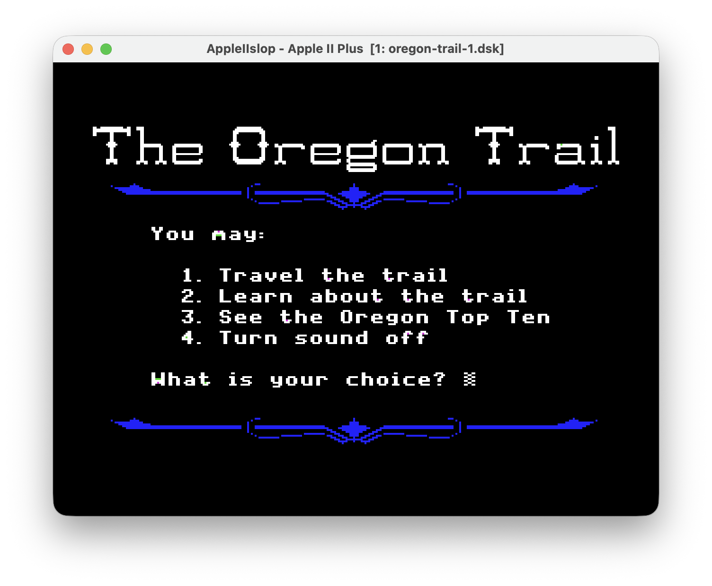

# AppleIIslop

An Apple II Plus emulator written in Kotlin Multiplatform, with a Swing desktop
interface. The 6502 CPU and Apple II hardware run in platform-independent
modules, separate from the desktop display, audio and file handling.



## Run

Requires JDK 17 or newer (`JAVA_HOME`, `.tools/jdk`, or Java on PATH).

```sh
./run.sh --no-disk                         # Applesoft BASIC
./run.sh --disk disks/dos33-master.dsk      # boot DOS 3.3
./run.sh --no-disk --type 'PRINT 2+2\n' --screenshot build/basic.png
./run.sh --help
```

The Disk II interface is fitted by default. With no disk in drive 1 its boot ROM
waits for media: press **F12 / RESET** to enter BASIC, or use `--no-disk`.
Insert a disk and choose **Machine > Power Cycle** to boot it.

**Machine** provides pause, power cycle and sound. **Edit** pastes as typing.
**Keys** provides RESET, ESC and CTRL+C. **Tape** inserts WAV cassettes and
provides Play, Record, Stop, Rewind, Eject and Save As. **Disk** manages two drives with insert,
eject, blank disk, write protection and Save As. **View** offers 1x/2x scaling
and a green monitor. **Help > Keyboard** explains the controls. Letters become
uppercase; arrows map to the Apple II's erase/copy keys; Ctrl+letter sends a
control code. Menu shortcuts use Command on macOS and Ctrl+Shift elsewhere.

The window is 640 × 480 at 1x, with nearest-neighbour scaling and a 4:3 display.
Disk formats are `.dsk`/`.do` (DOS sector order), `.po` (ProDOS order) and `.nib`.
Desktop disk changes are saved to their source file when the motor stops,
on eject, or on shutdown. Disks inside a packaged app stay in memory until
**Save Disk As**. Headless runs never write back to source disk images.
A new blank disk needs formatting with DOS `INIT`; it has no filesystem yet.

Other options include `--disk2 FILE`, `--roms DIR`, `--frames N`, `--mono`,
`--no-sound`, `--disassemble A-B`, `--origin ADDR` and `--log-keys`.
ROMs are included in the desktop jar; `--roms` overrides them.

### Example: The Oregon Trail

With the game's disk images saved locally in `disks/`, boot the first disk:

```sh
./run.sh --disk disks/oregon-trail-1.dsk
```

When the game asks for the other side, choose **Disk > Drive 1 > Insert Disk...**
and select `oregon-trail-2.dsk`. These game images are not bundled with the project.

## Cassettes

Use `./run.sh --no-disk` for Applesoft's cassette commands. Tape playback and
recording run at real speed, using the original ROM routines and the emulated
cassette input/output jacks. The recorder has manual controls: the Apple II
cannot start or stop its motor. Tape audio is not mixed into the host speaker.

To load:

1. **Tape > Insert Tape...** selects a WAV file.
2. Type `LOAD` and press Return, then select **Tape > Play**.
3. When the BASIC prompt returns, type `RUN`.

To save:

1. Enter a BASIC program, then choose **Tape > New Blank Tape** and **Record**.
2. Type `SAVE` and press Return (without a filename).
3. Wait for the BASIC prompt, choose **Stop**, then **Save Tape As...**.

**Rewind** stops and returns to the start; choose **Play** to replay. Recording
writes over the tape at its current position and extends it as needed. Save As
stops the recorder and exports a snapshot. Recordings stay in memory until
saved: save before ejecting, replacing a tape or closing the application.
Power Cycle keeps the tape, stopped and rewound; RESET leaves the recorder alone.

The CLI inserts and starts playback automatically:

```sh
./run.sh --no-disk --tape program.wav --type 'LOAD\nRUN\n'
./run.sh --no-disk --tape program.wav --type 'LOAD\nRUN\n' --screenshot build/tape.png
```

Headless runs wait for playback to finish, up to the usual two-minute extension
beyond `--frames`; increase `--frames` for longer tapes. For short-leader tapes,
use the window's manual Play control after typing LOAD.

Supported input: uncompressed PCM WAV, 8- or 16-bit, mono or stereo, 8–192 kHz.
Stereo channels are averaged; opposite-phase channels can cancel, so convert
such recordings to one channel first. Output is mono 16-bit WAV (44.1 kHz for
new tapes). Compressed audio, UEF and CAS images are not supported. Clean ROM
recordings are tested; noisy archival recordings may need audio cleanup.

Cassette regression tests save a BASIC program through the real ROM, export
WAV, then load and run it in a fresh machine through the headless CLI path.
The input comparator polarity was checked against
[MAME's Apple II driver](https://github.com/mamedev/mame/blob/master/src/mame/apple/apple2.cpp).

## Structure

- `cpu/src/commonMain`: NMOS 6502 and disassembler.
- `apple2/src/commonMain`: 48 KiB RAM, 16 KiB Language Card, memory bus,
  keyboard latch, soft switches, speaker, video and slot-6 Disk II.
- `desktop/src/jvmMain`: Swing UI, emulation worker, audio, file I/O and CLI.
- `commonTest` / `jvmTest`: CPU vectors, real-ROM boot and disk integration tests.

Core modules declare JVM, macOS, Linux and Windows Native targets. Verification
so far covers JVM only. Video supports 40-column text, lo-res, hi-res, mixed
mode, page switching and approximate NTSC artifact colours. This is an Apple II
Plus, not a IIe: no 80-column card, auxiliary RAM or double hi-res. Cassette I/O uses PCM WAV recordings; paddles exist in the core but have no host input mapping.
Copy-protected disk timing and analog composite-video effects are not complete.

## Build and verify

```sh
./gradlew :cpu:jvmTest :apple2:jvmTest :desktop:jvmTest :desktop:fatJar
java -jar desktop/build/libs/appleiislop.jar --no-disk
./gradlew :desktop:packageApp
./gradlew :desktop:packageDmg       # macOS only
```

Gradle is pinned to 9.7.0 and Kotlin to 2.4.21.
Native packages include a Java runtime. JVM tests and the runnable jar have
been verified with Gradle; native package tasks have not been exercised.

Tests cover BASIC execution and RESET, DOS boot/save/reload, sector-order and
nibble round trips, bundled ROMs, screenshot output and option validation.

## Credits and licensing

Source code is BSD-3-Clause; see [LICENSE](LICENSE) and [NOTICE](NOTICE).

CPU verification uses Thomas Harte and contributors' SingleStepTests / 65x02
vectors and Klaus Dormann's 6502 functional test. Their sources, licences and
fixture details are recorded in the
[test fixture documentation](cpu/src/jvmTest/resources/reference/README.md).

ROM and operating-system disk images are separate third-party material, not
covered by the source-code licence; see `roms/README.md` and `disks/README.md`.
